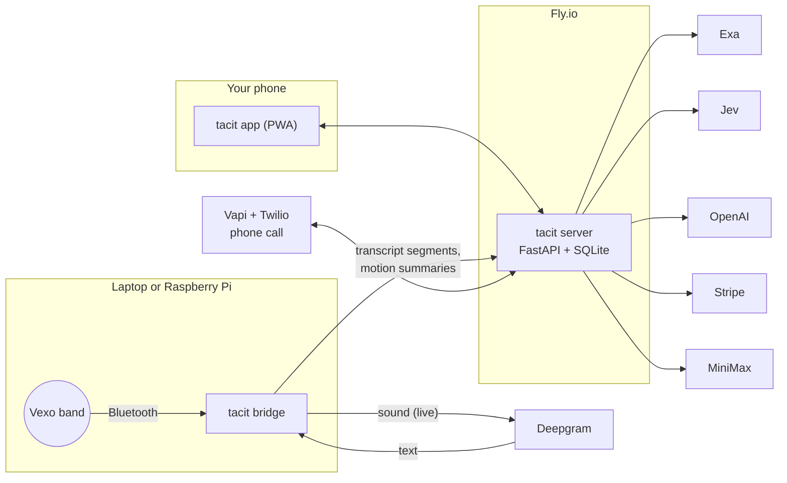
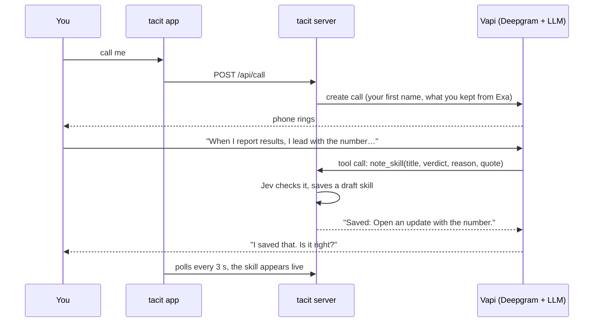

<div align="center">

# tacit

### *agents have skills. people have taste. tacit is how it gets around.*

**A network for tacit knowledge: the things people know how to do but never wrote down.**
A short phone call and a wristband turn what you say into skills signed with your name.

[Live app](https://tacit-vexohacks.fly.dev/app/) · [Landing page](https://tacit-vexohacks.fly.dev/) · [How it works](#how-it-works) · [Run it](#run-it) · [Privacy](#privacy)

*Built in one day at VexoHacks, San Francisco, November 14, 2026. A prototype.*

</div>

---

## What it is

Most of what experienced people know never gets written down: how they open a hard
conversation, why they cut scope on a Monday, the one question they always ask a customer.
It lives in conversations and it disappears with them.

**tacit keeps it.** A **skill** is one thing a person knows how to do, in their own words:

| part | example |
|---|---|
| **title** | Open an update with the number |
| **verdict**, what to do | Lead with the one number that changed, then tell the story. |
| **reason**, why | People forget the story. They remember forty percent. |
| **quote**, their exact words | *"They forget the story. They remember 40%."* |

Every skill is signed by the person who said it. **Learners** follow **experts**; their feed
fills with skills they can use, and their agents can apply them.

## The journey

| | step | what happens | powered by |
|---|---|---|---|
| 1 | **Connect your context** | Give your name, number and a few links. With your consent, tacit looks you up on the web. You keep or remove each thing it found. | **Exa** |
| 2 | **Have a short conversation** | tacit calls you (or you call it) and asks about something you know how to do. Each skill it hears is saved **during the call**. | **Vapi**, **Deepgram** (Nova-3 ears, Aura voice) |
| 3 | **Check and publish** | Every saved skill is a draft. Jev scores whether it is *specific* and *really yours*; you edit, publish, or remove it. | **Jev** (TypeSafe) |
| 4 | **Grow your network** | People follow you. Followers-only skills unlock with a one-time payment. | **Stripe** (test mode) |
| 5 | **Wear the band** | The Vexo band notices advice given and received in everyday conversations. Advice you give becomes a draft skill; advice passed between two tacit wearers becomes a *pass* in both feeds. | **Vexo Open band**, Deepgram, Jev, OpenAI |

A profile picture can be made with **MiniMax** and is kept only as a portrait drawn in dots.

## How it works



- **The server** (`src/tacit/app.py`) serves the API, the app, the landing page and the Vapi and
  Stripe webhooks. One machine, one SQLite database on a volume.
- **The app** (`pwa/`) is plain HTML, CSS and JavaScript modules. No framework, no build step,
  installable on a phone.
- **The bridge** (`src/tacit/bridge.py`) runs next to the band. It holds the Bluetooth link,
  streams sound to Deepgram, detects gestures and motion, and owns **mute**. Raw motion never
  leaves it; raw sound goes only to Deepgram.

### The interview call



No transcript, recording or summary of the call is stored: only the skills you approve.

### What the band notices

Speech goes through **windows** of up to three minutes. For each window, **Jev** answers one
typed question per kind of moment; when it is sure enough, **OpenAI** extracts the details
into a strict JSON schema. A quote is kept only if it appears word for word in what was said.

| kind | from | becomes |
|---|---|---|
| advice given, explanation, lesson | sound | a **draft skill** for you |
| demonstration (explaining while drawing) | sound + motion | a draft skill, ranked first |
| advice received | sound | a private "picked up" item; a **pass** if the giver wears tacit too |
| question, decision, commitment, recommendation, idea | sound | your private timeline; a recommendation, lesson or idea can be shared as a post |
| conversation, presenting | sound (+ motion) | private spans |
| writing, drawing, whiteboard, typing, making | motion | creative sessions ("ana sketched for 25 minutes", shared only if you turn it on) |
| someone asks to stop recording | sound | **mute** and rewind |

**Passes.** When two tacit wearers talk, both bands upload, and the server sees their
conversations overlap. Advice given on one band and received on the other becomes a pass:
*"maya passed **open an update with the number** to ana."* It shows up in both feeds once the
giver publishes the skill. Other bands are only ever known through the server, never over
Bluetooth.

## The band

| do this | and |
|---|---|
| draw an **X** or a **figure 8** in the air | **mute**: the mic goes off at once, the LED blinks white twice, and the last 15 s are dropped |
| say **"stop recording"**, "off the record", "don't record"… | anyone nearby can mute the band |
| press **mute** in the app | mutes within two seconds |
| the same gesture **then a double-tap** within 3 s, or **unmute** in the app | listening again; mute never times out |
| **double-tap** | "keep that": the last minute is kept and checked for anything worth saving |

**Blue light means listening. No blue means not listening.** The app shows the blue
*listening* pill only while the band really is.

Mute is local: it works without internet, and the band comes back muted after a restart if it
was muted. With no internet the bridge keeps the sound in a buffer on its own disk (capped, 24 hours at
most, deleted by a mute's rewind), transcribes it when the internet returns, and then deletes it.

> The gesture thresholds are first guesses from synthetic motion. Record your own with
> `tacit gestures record x` to make them reliable on your wrist.

## Privacy

This product listens to people, so it is built to be conservative about sharing:

- **Consent first.** "Look me up" and "tacit may call me" start unticked, and each is needed for its feature.
- **Nothing public by default.** Every skill starts as a draft; every band moment is private until you choose otherwise.
- **No recordings kept.** Calls keep only the skills you approve. Band transcripts are deleted after 24 hours, or at once on mute.
- **Bystanders are protected.** People who never signed up are never quoted, credited, or published, and anyone can mute the band by asking.
- **Your photo stays yours.** It goes to MiniMax only with your consent and is never stored; only the dot portrait is.
- **Delete everything** really deletes every row about you.
- **Logs** never contain names, phone numbers, skill text, transcripts or keys.
- Outbound calls go only to numbers on an allowlist; Stripe refuses live keys; the bridge connects only to the team's own bands.

## Run it

You need Python 3.11 and [uv](https://docs.astral.sh/uv/).

```sh
git clone https://github.com/ziadgit/tacit && cd tacit
scripts/bootstrap.sh            # clones the Vexo kit, installs everything, creates .env
```

Fill in `.env` (every setting has a one-line comment in `.env.example`). At minimum:

```sh
SESSION_SECRET=...              # openssl rand -hex 32
```

```sh
.venv/bin/tacit doctor          # checks the kit, your band number and every key, never prints one
.venv/bin/tacit serve           # http://127.0.0.1:8000 : landing at /, the app at /app/
```

Each feature turns on when its key is set: `EXA_API_KEY` (look me up), `VAPI_*` and
`CALL_ALLOWLIST` (calls), `TYPESAFE_API_KEY` (Jev), `OPENAI_API_KEY` (band extraction),
`STRIPE_SECRET_KEY` (test mode), `MINIMAX_API_KEY` (pictures). Without them the app still runs.

### The band

1. In the app, **profile → your band**, pick your band. Copy the lines it shows into `.env`
   (`TACIT_BAND`, `TACIT_BRIDGE_TOKEN`, `TACIT_SERVER_URL`), plus `DEEPGRAM_API_KEY`.
2. Close the kit's dashboard. Double-tap the band. Don't pair it in your computer's Bluetooth menu.
3. Run the bridge:

```sh
.venv/bin/tacit bridge          # the real band, over Bluetooth
.venv/bin/tacit bridge --sim    # no band: the kit's pretend band, with a scripted voice
```

One laptop drives one band. A second band needs a second laptop (or a Pi) with its own `.env`.

### Phone calls (Vapi)

Vapi has to reach your server, so this needs a public https address (Fly.io below, or a tunnel).

```sh
.venv/bin/tacit vapi-sync --dry-run   # the assistant, every secret shown as ***
.venv/bin/tacit vapi-sync             # creates it; add the VAPI_ASSISTANT_ID it prints to .env
```

For outbound calls, import a carrier number (for example Twilio) into Vapi; free Vapi numbers
only take incoming calls. Give the number **no assistant** and set its server URL to
`https://<your app>/vapi/webhook` with the header `x-tacit-secret: <VAPI_SERVER_SECRET>`: tacit
then answers callers who signed up. Set `VAPI_PHONE_NUMBER_ID`, `TACIT_PHONE_DISPLAY` and
`CALL_ALLOWLIST` (your test numbers).

### Payments (Stripe, test mode)

```sh
stripe listen --forward-to localhost:8000/stripe/webhook    # prints whsec_… for STRIPE_WEBHOOK_SECRET
```

## Deploy

The server runs on [Fly.io](https://fly.io) as **one machine with one volume** (SQLite can't
be shared), always on so the webhooks answer at once.

```sh
fly apps create tacit-vexohacks
fly volumes create tacit_data --region sjc --size 1
fly secrets set SESSION_SECRET=... VAPI_SERVER_SECRET=... VAPI_API_KEY=... \
  VAPI_ASSISTANT_ID=... VAPI_PHONE_NUMBER_ID=... TACIT_PHONE_DISPLAY=... CALL_ALLOWLIST=... \
  DEEPGRAM_API_KEY=... EXA_API_KEY=... TYPESAFE_API_KEY=... OPENAI_API_KEY=...
fly deploy
```

If Fly doesn't give the app public addresses, run `fly ips allocate-v4 --shared` and
`fly ips allocate-v6`. Back up with `fly ssh console -C "sqlite3 /data/tacit.db .dump"`.
A Raspberry Pi can be an off-grid hub for the bridge: see [`deploy/pi/`](deploy/pi/README.md).

## Repository map

```
src/tacit/
  app.py          the FastAPI server: routes, CSP, static mounts
  auth.py         signed session cookie, Origin check
  store.py        SQLite store; delete_user removes every row
  context.py      Exa lookup, kept / removed review
  interview.py    Vapi assistant, calls, webhook (skills saved mid-call)
  judge.py        Jev: is this skill specific, and really theirs?
  network.py      skills, people, follows, the typed feed
  payments.py     Stripe Checkout and webhook, test keys only
  portraits.py    MiniMax pictures → dot portraits
  bridge_api.py   pairing, bridge state, mute commands, uploads, rewind
  bridge.py       the band bridge: streams, mute, Deepgram, uploads
  gestures.py     X / figure-8 recogniser (a port of the kit's gesture trainer)
  motion.py       writing / drawing / typing / making detectors
  scenarios.py    windows → Jev → extraction → moments
  moments.py      skills from conversations, passes, the moments API
  offline.py      the offline sound buffer, prerecorded transcription
  llm.py          OpenAI Responses API with strict JSON schemas
  cli.py          tacit doctor | serve | vapi-sync | bridge | gestures
  *_test.py       tests beside the code (no network: respx and fakes)
pwa/              the app: index.html, app.js, api.js, style.css, sw.js
landing/          the landing page
design-system/    the tacit design system: tokens, rules, shared classes
deploy/pi/        systemd unit and guide for a Raspberry Pi hub
SPEC.md           the build spec    fix_plan.md   the backlog    CLAUDE.md   working notes
```

## Tests

```sh
.venv/bin/ruff check . && .venv/bin/pytest -q
```

Over 200 tests, none of which touch the network: HTTP is mocked with `respx`, Exa, Jev and
Stripe are fakes, and the band is the Vexo kit's **pretend band**, which plays X and figure-8
gestures, drawing, a shake and an idle swing.

## Design

The look comes from the tacit design system ([`design-system/README.md`](design-system/README.md)):
a lavender ground with grain and one warm glow, drawings made only of plus signs, dashes and
dots, and people as the handwritten part. **Blue means only that the band is listening;
orange means only that a skill is passing right now.** The feed follows the team's
Subframe design: lines, not cards.

## Status and known limits

- A one-day prototype. Gesture and motion thresholds are guesses until tuned on real wrists.
- iPhone browsers can't use Web Bluetooth, so the bridge runs on a laptop or a Pi, not on the phone.
- Not built yet: payouts to experts (Stripe Connect), "send to my agent", "used your skill",
  and asking the feed questions out loud. See `fix_plan.md` → Discovered.

## Thanks

Built with the **Vexo Open** band and kit, **Deepgram**, **Exa**, **Jev by TypeSafe**,
**Vapi**, **Twilio**, **OpenAI**, **Stripe**, **MiniMax** and **Fly.io**, at VexoHacks 2026.
The people shown on the landing page and in examples are invented.
